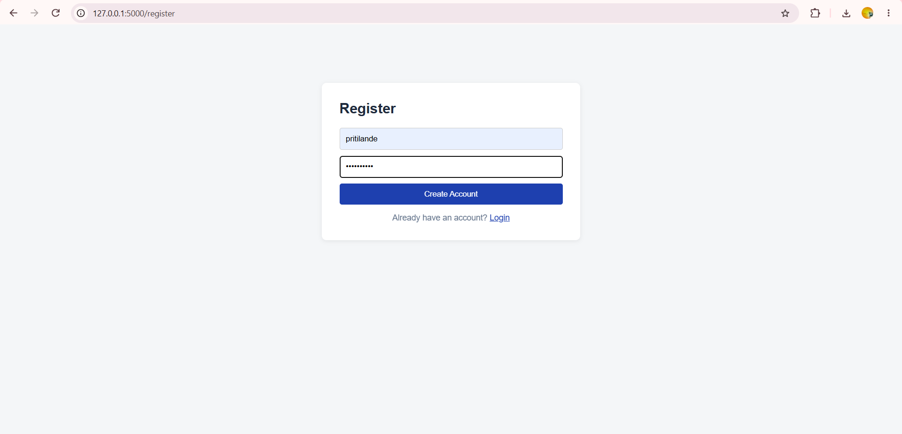
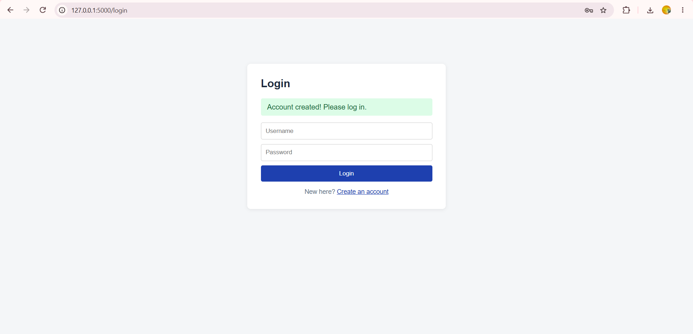
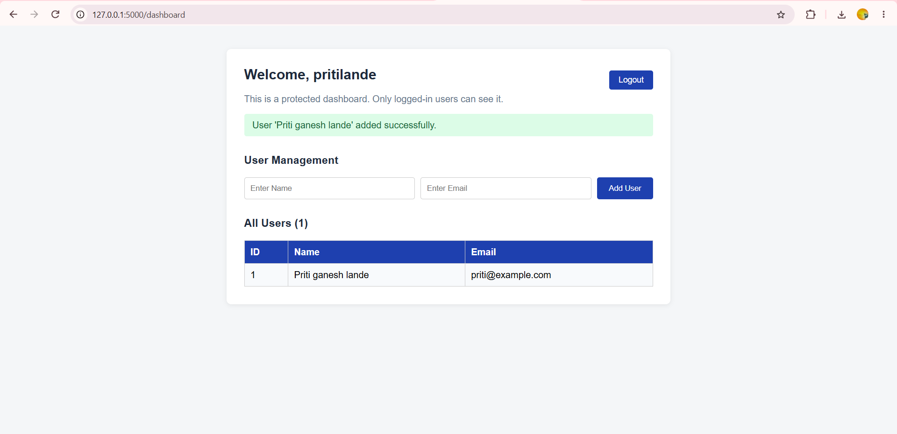

# User Authentication System (Python Full Stack - Task 2)

Task 2 of the MainCrafts Technology internship. It extends the Task 1 User Management app
with registration, login, logout, password hashing, session-based authentication and a
protected dashboard.

## Technologies Used
- **Backend:** Python 3 + Flask
- **Frontend:** HTML (Jinja2 templates) + CSS
- **Database:** SQLite
- **Security:** Werkzeug password hashing
- **Sessions:** Flask built-in signed-cookie session

## Features
1. User registration (signup) with validation and duplicate-username check
2. User login
3. Password hashing (passwords are never stored in plain text)
4. Session-based authentication
5. Protected dashboard (Task 1's user management now lives behind login)
6. Logout
7. Extras: reusable `@login_required` decorator, flash messages, tables auto-created on first run

## Project Structure
```
python-fullstack-task2/
├── app.py              # routes, auth logic, database operations
├── database.db         # SQLite database (created on first run)
├── requirements.txt
├── LICENSE
├── templates/
│   ├── login.html
│   ├── register.html
│   └── dashboard.html  # protected page: welcome + Task 1 user management
├── static/
│   └── style.css
└── screenshots/        # registration.png, login.png, dashboard.png
```

## Database
| Table | Columns | Purpose |
|---|---|---|
| `users` | id, username (UNIQUE), password (hashed) | login accounts |
| `managed_users` | id, name, email (UNIQUE) | records managed on the dashboard (Task 1's table, renamed so it doesn't clash with the login `users` table) |

## Authentication Flow
1. **Register** (`/register`): input is validated, the password is hashed with
   `generate_password_hash` (salted), and only the hash is saved. A duplicate username
   is caught by the UNIQUE constraint and shown as an error.
2. **Login** (`/login`): the user is looked up with a parameterised query (safe from SQL
   injection) and `check_password_hash` compares the typed password with the stored hash.
   On success the session is cleared and `session["user"]` is set.
3. **Protected route** (`/dashboard`): the `@login_required` decorator checks the session.
   Not logged in -> redirected to `/login`.
4. **Logout** (`/logout`): `session.clear()` removes the login and redirects to `/login`.

## How to Run
```bash
pip install -r requirements.txt
python app.py
```
Open http://127.0.0.1:5000/register, create an account, log in, and you land on the dashboard.

## Security Notes
- Passwords are hashed, never stored in plain text.
- The same error is shown for a wrong username or a wrong password.
- The secret key comes from the `SECRET_KEY` environment variable (random fallback for local dev).
- `debug=True` is for development only; turn it off in production.
- Next steps: CSRF protection (Flask-WTF), login rate limiting, logout via POST, HTTPS-only cookies.

## Screenshots

### Registration


### Login


### Dashboard

